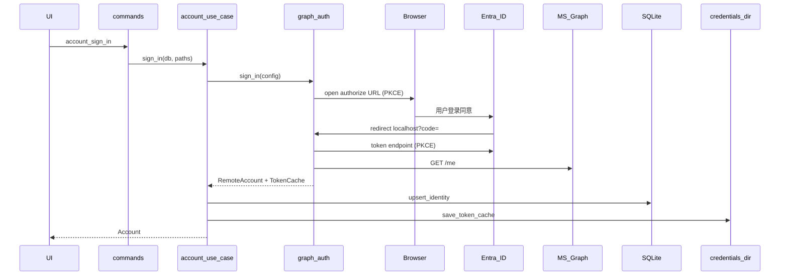

# V1.0.0 登录 / OAuth 后端规格

阶段 A（身份与密钥）的实现契约。总览见 [backend-remaining.md](./backend-remaining.md)；实体与 Port 见 [ports-entities.md](./ports-entities.md)。

---

## 1. 目标与验收

| 目标 | 验收 |
|---|---|
| Outlook 用户可在桌面端完成微软登录 | `account_use_case::sign_in` 返回本地 `Account` |
| Token 不进业务表 | 仅写入 `app_local_data_dir/credentials/` |
| 重启可恢复会话 | 有凭证文件的账户可通过 `get_access_token` 刷新 |
| 登录不覆盖显示配置 | 重登同一账户时 `show_group_messages_in_contact_conversation` 不变 |
| 退出清除凭证 | `sign_out` 删除该账户凭证；**本地邮件库保留** |

本阶段**不**实现邮件 Delta / 联系人同步；登录成功后即可持有可刷新的 Graph access token，供后续阶段 B 使用。

---

## 2. 已拍板决策

| 项 | 选择 |
|---|---|
| OAuth 流程 | **授权码 + PKCE**；系统浏览器；回跳地址来自配置 |
| 客户端类型 | Azure **机密客户端**（`client_secret` 来自配置文件） |
| SDK | `graph-rs-sdk`（`AuthorizationCodeCredential` + `ConfidentialClientApplication`） |
| Client ID / Secret / Redirect | **全部**从 `azure.json` 读取（无环境变量覆盖） |
| Tenant | 配置项，默认 `common` |
| Token 存储 | `credentials/{account_id}.json`；禁止写入 SQLite 业务表 |
| 退出策略 | 删凭证；保留 `accounts` 行与本地邮件 |

### 2.1 Azure 应用注册（开发者手工）

在 Entra ID → 应用注册中创建：

1. 账户类型：多租户 + 个人 Microsoft 账户（或按产品需要收窄）
2. 平台：Web（机密客户端）或等价；创建 **client secret**
3. 重定向 URI：与配置文件 `redirect_uri` **完全一致**（含端口与尾斜杠），例如 `http://localhost:8765/`
4. API 权限（委托）：至少  
   `openid` `profile` `offline_access` `User.Read`  
   并为后续同步/发送预申：`Mail.ReadWrite` `Mail.Send` `Contacts.Read`  
5. 将 client_id、secret、redirect_uri 写入配置文件（见 §3）

---

## 3. 配置

路径：`{app_config_dir}/azure.json`  
Windows 示例：`%APPDATA%\com.postlet.app\azure.json`  
模板：[`src-tauri/azure.json.example`](../../src-tauri/azure.json.example)

```json
{
  "client_id": "xxxxxxxx-xxxx-xxxx-xxxx-xxxxxxxxxxxx",
  "client_secret": "your-client-secret",
  "redirect_uri": "http://localhost:8765/",
  "tenant": "common"
}
```

| 字段 | 必填 | 说明 |
|---|---|---|
| `client_id` | 是 | Azure Application (client) ID |
| `client_secret` | 是 | 客户端密钥（日志中脱敏） |
| `redirect_uri` | 是 | 本机回跳，须含端口；主机限 `localhost` / `127.0.0.1` |
| `tenant` | 否 | 默认 `common`；可为 `organizations` / `consumers` / 租户 GUID |

缺少任一必填字段时 `sign_in` 返回 `validation`。监听器绑定该 `redirect_uri` 的主机与端口，不再使用临时端口。

模块：`infrastructure/config/azure.rs`；由 `AppPaths.config_dir` 加载。

---

## 4. 调用链

```text
UI AccountPort.signIn
  → Tauri command account_sign_in
    → account_use_case::sign_in(db, paths)
      → config::load_azure(config_dir)
      → graph::auth::sign_in(credentials_dir, azure_config)   // 浏览器 + localhost + 换票 + /me
      → accounts::get_by_home_account_id | get_by_email | 新建 AccountId
      → accounts::upsert_identity（不覆盖显示/同步字段）
      → graph::auth::save_token_cache(credentials_dir, account_id, tokens)
      → 返回 Account
```

Graph / OAuth **仅**出现在 `infrastructure/graph/*`。  
`commands/` 只做 IPC：取 `AppState` → 调用例。



---

## 5. `graph::auth` 模块契约

路径：`src-tauri/src/infrastructure/graph/auth.rs`（可拆 `token_store.rs` / `loopback.rs`）

```rust
pub struct AzureAuthConfig {
    pub client_id: String,
    pub client_secret: String,
    pub redirect_uri: String, // 须含显式端口，与 Entra 注册一致
    pub tenant: String,       // 默认 common
}

pub struct TokenCache {
    pub access_token: String,
    pub refresh_token: Option<String>,
    pub expires_at_ms: i64,
    pub scopes: Vec<String>,
    pub home_account_id: Option<String>,
}

/// 打开系统浏览器，按 config.redirect_uri 监听回跳，换票后拉取 /me。
pub async fn sign_in(
    credentials_dir: &Path,
    config: &AzureAuthConfig,
) -> Result<(RemoteAccount, TokenCache), PortError>;

pub async fn sign_out(credentials_dir: &Path, account_id: &AccountId) -> Result<(), PortError>;

pub async fn get_access_token(
    credentials_dir: &Path,
    config: &AzureAuthConfig,
    account_id: &AccountId,
) -> Result<String, PortError>;

pub async fn save_token_cache(
    credentials_dir: &Path,
    account_id: &AccountId,
    cache: &TokenCache,
) -> Result<(), PortError>;

pub async fn list_signed_in_accounts(
    credentials_dir: &Path,
) -> Result<Vec<AccountId>, PortError>;
```

### 5.1 授权细节

- PKCE：每次登录 `ProofKeyCodeExchange::oneshot()`（禁止进程级静态复用）
- Redirect：使用配置 `redirect_uri`；监听器绑定其主机与端口（`localhost` → `127.0.0.1`）
- 换票：`ConfidentialClientApplication` + `client_secret` + PKCE
- 回跳页：返回简短 HTML「可关闭此窗口」；解析 `code` / `error`
- 超时：登录等待建议 5 分钟；超时 → `Auth`
- Scopes（空格分隔，一次同意）：  
  `openid profile offline_access User.Read Mail.Read Contacts.Read`
- `/me` 映射：`mail` 或 `userPrincipalName` → email；`displayName`；`id`；从 token 或 `/me` 补 `tenant_id`；`home_account_id` = `{oid}.{tid}`（有则写）

### 5.2 Token 文件

- 路径：`credentials/{account_id}.json`
- 内容：`TokenCache` 的 serde JSON（含 refresh_token）
- `get_access_token`：未过期直接返回；过期则用 refresh_token 刷新并回写；无 refresh → `Auth`（需重新登录）
- 错误信息脱敏：不向 `AppError.message` 回传 access/refresh token

### 5.3 `RemoteAccount`

`RemoteAccount.account_id` 在 auth 返回时填 **Graph 用户 oid**（远端身份提示）。  
**本地** `AccountId` 由用例分配/解析，不由 Graph oid 直接充当（除非已有绑定）。

---

## 6. Application：`account_use_case`

```rust
pub async fn sign_in(db: &SqlitePool, paths: &AppPaths) -> Result<Account, AppError>;
pub async fn sign_out(db: &SqlitePool, paths: &AppPaths, account_id: &AccountId) -> Result<(), AppError>;
```

`sign_in` 编排：

1. 加载 `AzureAuthConfig`（缺失 client_id / client_secret / redirect_uri → validation）
2. `graph::auth::sign_in`（网络 / 浏览器；**事务外**）
3. 解析本地账户：  
   - `home_account_id` 命中 → 复用  
   - 否则 `email` 命中 → 复用并补写 home_account_id  
   - 否则新建 `AccountId`（UUID）
4. 事务内 `upsert_identity`：写入/更新 email、display_name、aliases、tenant_id、home_account_id；**不**改显示开关与同步游标/状态
5. `save_token_cache`
6. 返回最新 `Account`

`sign_out`：

1. `graph::auth::sign_out`（删凭证；远端 revoke 为 best-effort，失败不阻断）
2. 不删 SQLite 账户与邮件

---

## 7. Repository 增补

`accounts`：

| 函数 | 说明 |
|---|---|
| `get_by_home_account_id` | 按 `home_account_id` 查 |
| `upsert_identity` | INSERT 全字段默认；ON CONFLICT 只更新身份字段与 `updated_at` |

现有 `upsert` 仍可供 seed / 全量写入；**登录路径必须走 `upsert_identity`**。

---

## 8. Tauri commands

| Command | 参数 | 说明 |
|---|---|---|
| `account_sign_in` | 无 | → `sign_in` |
| `account_sign_out` | `account_id: String` | → `sign_out` |

前端 Adapter 接线可在本阶段后单独做；后端先可 `invoke` 验收。

---

## 9. 非目标（本阶段不做）

- Device Code / 内嵌 WebView 登录  
- 系统钥匙串（V1 用 credentials 目录文件）  
- 退出时清空本地邮件  
- 邮件 / 联系人 Graph 同步  
- 前端直连 Graph 或持有 Token  

---

## 10. 手工验收清单

1. 写入 `azure.json` 的 `client_id` / `client_secret` / `redirect_uri`，且与 Entra 注册一致
2. 调用 `account_sign_in` → 浏览器弹出 → 同意 → 返回 Account
3. `credentials/` 下出现 `{account_id}.json`，库中有对应 `accounts` 行
4. 再登同一微软账户 → 同一本地 `AccountId`，显示开关不变
5. `account_sign_out` → 凭证文件消失；账户行仍在
6. 缺配置时错误为 validation，无 panic
