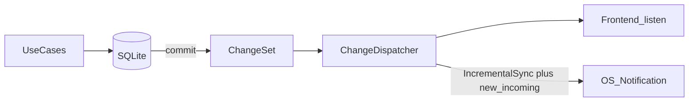

# V1.0.0 本地变更分发（ChangeSet）

将「数据变更」与「业务通知」分开：事务提交成功后产出 `ChangeSet`，由进程内 `ChangeDispatcher` 统一推 UI 失效与（按需）系统通知。  
总览见 [backend-remaining.md](./backend-remaining.md)。

---

## 1. 原则

1. **Graph（及未来其他远端）不知道 Tauri**：只提供远端数据，不发事件。  
2. **UI 事件是数据失效通知**，不是完整数据传输：告诉前端哪些账户/会话可能变了，再经 Port 读 SQLite。  
3. **系统通知由业务语义触发**，不由「某张表变了」直接触发：须识别真正新增的入站来信，并去重。  
4. **事件仅在事务 commit 成功之后**分发。  
5. **兜底**：UI 初始化、窗口恢复或漏事件后，重新读 SQLite，不依赖每条事件必达。

**不用** SQLite Trigger 作为主事件源：库不知道本次是增量来信、历史导入还是聚合重算。

---

## 2. 数据流

```text
写入入口（sync / aggregate / 用户操作 / …）
  → SQLite 事务（messages / conversations / …）
  → commit 成功
  → 组装 ChangeSet（application/dto）
  → runtime::change_dispatcher::dispatch
       ├─ emit mail.changed（UI 失效）
       └─ origin=IncrementalSync 且 new_incoming 非空 → 系统通知策略
```



---

## 3. `ChangeSet` 契约

路径：`src-tauri/src/application/dto/change_set.rs`

```rust
pub struct ChangeSet {
    pub account_id: AccountId,
    pub conversation_ids: Vec<ConversationId>,
    pub message_ids: Vec<MessageId>,
    pub new_incoming_ids: Vec<MessageId>,
    pub origin: ChangeOrigin,
}

pub enum ChangeOrigin {
    InitialSync,      // 历史灌库：刷 UI，不弹系统通知
    IncrementalSync,  // 增量来信：可通知
    UserAction,       // 已读 / 发送等：刷 UI，不通知
    Rebuild,          // 聚合 / 配置重投影：刷 UI，不通知
}
```

| origin | UI 刷新 | 系统通知 |
|---|---|---|
| `InitialSync` | 是 | 否 |
| `IncrementalSync` | 是 | 仅 `new_incoming_ids`（再经已读/当前会话等策略） |
| `UserAction` | 是 | 否 |
| `Rebuild` | 是 | 否 |

`new_incoming_ids`：本轮**真正新增**的入站消息本地 ID；重复 Delta upsert、outbound、已读变更不得填入。

---

## 4. 分发器

路径：`src-tauri/src/runtime/change_dispatcher.rs`（与 mail/aggregate scheduler 同级）

- 持有 `AppHandle` + 进程内单调 `generation`
- `dispatch(ChangeSet)`：空变更直接返回  
- UI：`emit("mail.changed", MailChangedEvent { account_id, generation, origin, conversation_ids, message_ids, new_incoming_count })`  
- 通知：V1 可先 stub；接入 `tauri-plugin-notification` 后做汇总文案与去重  
- **高频合并**（后续）：同账户短窗口内多次 dispatch 可 coalesce 再 emit

用例 **返回** `ChangeSet`（或经 command 取出后调用 dispatcher）；用例与 repository **不**依赖 Tauri。

---

## 5. 谁组装 ChangeSet

| 写入 | origin | 说明 |
|---|---|---|
| 邮件 Delta 首轮 / 全量灌库 | `InitialSync` | 由 sync 用例标记 |
| 邮件 Delta 增量页 | `IncrementalSync` | 填 `new_incoming_ids` |
| `mark_read` / 发送 / 显示配置等 | `UserAction` | |
| 聚合 worker / 配置触发重投影 | `Rebuild` | |

仓储可返回「本事务触及的 id」碎片；**语义字段 `origin` / `new_incoming_ids` 由 Application 决定**。

---

## 6. 前端

- Adapter `listen('mail.changed')`，按 `generation` 丢弃过期事件  
- 收到后经现有 Port **重读**会话列表 / 当前会话消息 / 未读  
- 不把事件 payload 当邮件正文源  

---

## 7. 演进

- **持久化 outbox**：仅当要求崩溃不丢系统通知时，与业务写入同事务插入 outbox，dispatcher 改为捞表；`ChangeSet` 形状不变。  
- 当前产品只接 Graph；ChangeSet 不绑定 Graph，未来其他写入源共用同一 dispatcher。

---

## 8. 验收（骨架阶段）

1. `mark_read` commit 后发出 `mail.changed`，`origin=user_action`，含触及的 conversation/message id  
2. Application / repository 无 `tauri::emit`  
3. 空 `ChangeSet` 不 emit  
4. `cargo check` 通过  
